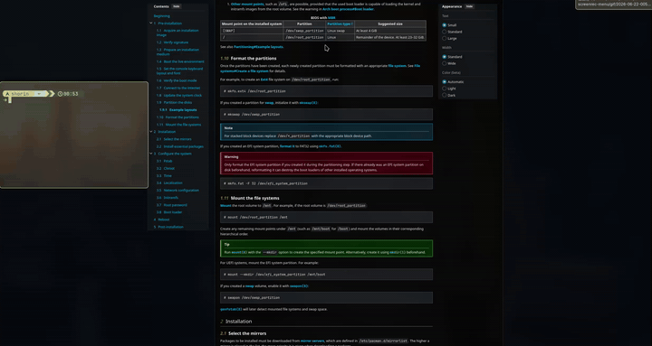

# wl-longshot

## [ENGLISH](README.md)

A scrolling screenshot tool for Wayland compositors.



## Installation

- Arch Linux

    ```
    yay -S wl-longshot-git
    ```

    Then you can simplye run the `wl-longshot`.

## Sponsor 赞助

If this project helps you, consider buying me a coffee ☕

如果这个项目帮到了你，欢迎请我喝杯咖啡 ☕ 你的支持会让它持续更新下去。

 

手机上看可以打开 [赞助页](https://github.com/SHORiN-KiWATA/.github/blob/main/SPONSOR.md)，支付宝能直接点链接付款。

## Thanks

- [snemc](https://github.com/jswysnemc): Provided the inspiration for the screen recording-based scrolling screenshot implementation.
- [SHORiN-KiWATA](https://github.com/SHORiN-KiWATA): Designed the specific implementation methods and features.
- [Google Gemini](https://gemini.google.com/): Completed the main logic and core code.